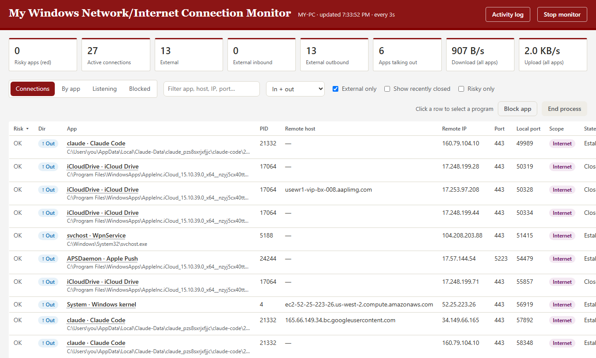
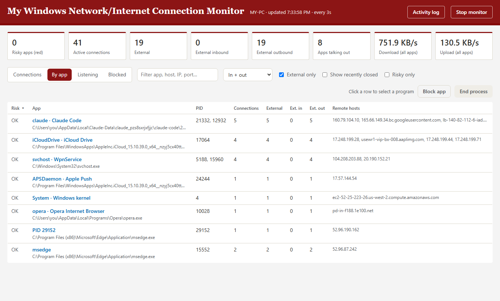
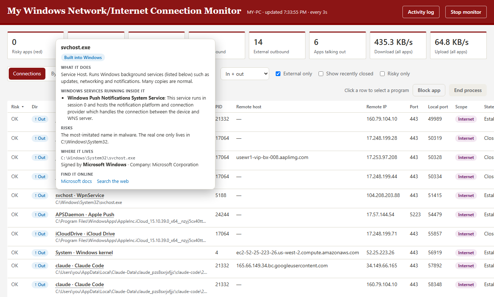
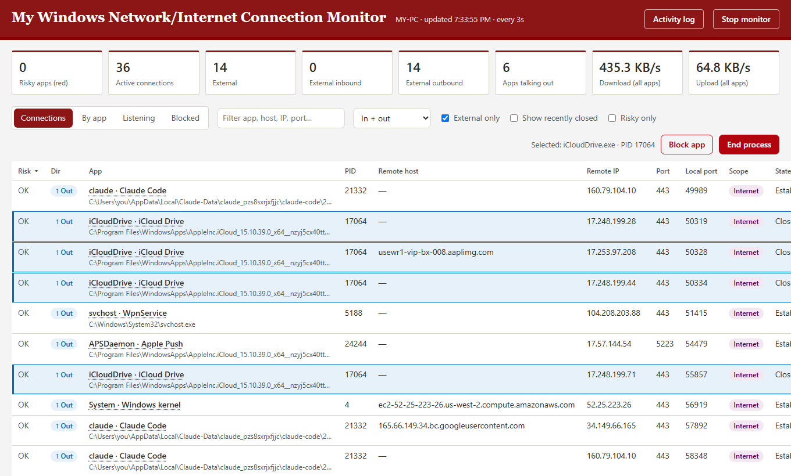
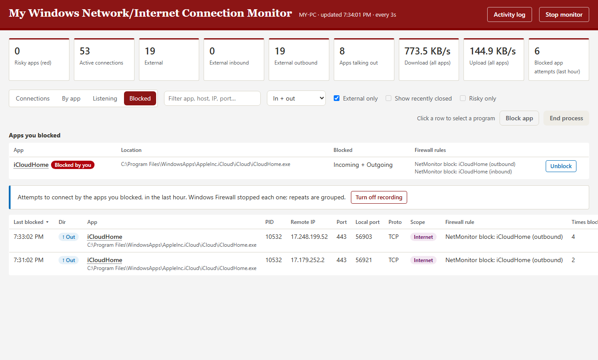
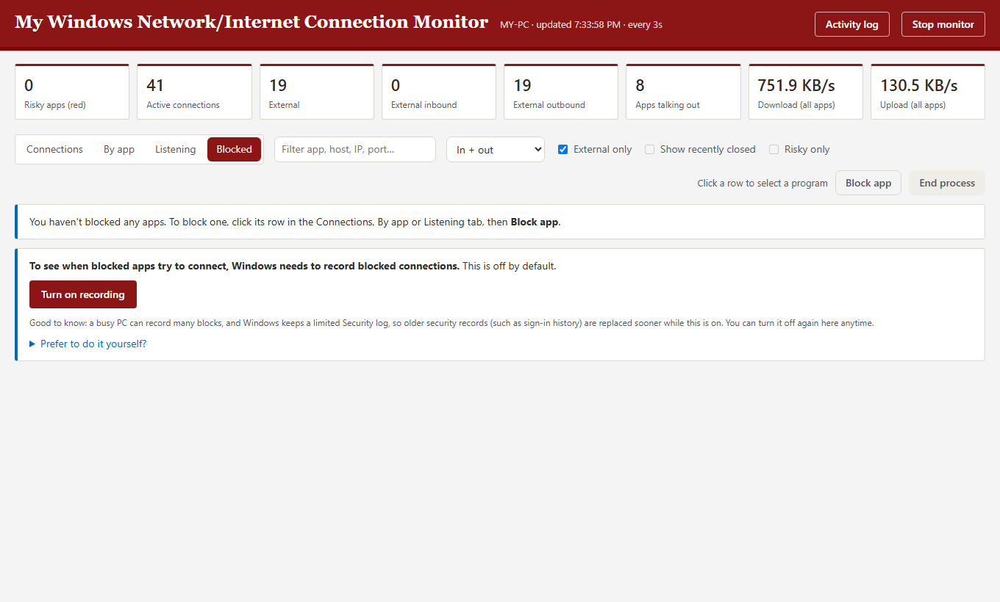

# My Windows Network/Internet Connection Monitor: quick guide

A small app that shows, live in your browser, every network connection your Windows PC is making, names the app behind each one, flags anything risky, and lets you stop or block apps.

*Screenshots: the PC name and Windows user name are hidden; the Blocked tab shows example data.*

---

## 1. Get it and start it

1. Download **NetMonitor.exe** from the latest Python release (`py-v…`) on the [Releases page](https://github.com/jaykaluza/iT-Toolset/releases).
2. **Check it's genuine:** in PowerShell, in the folder with the file, run `Get-FileHash .\NetMonitor.exe -Algorithm SHA256` and compare the result with the fingerprint in the release notes. They must match exactly.
3. Put it in a folder of its own (for example `Documents\NetMonitor`), then **double-click it**.
4. Windows may say **"Windows protected your PC"** (the app isn't digitally signed): click **More info → Run anyway**.
5. Click **Yes** when Windows asks to allow it to make changes. It needs administrator rights to see every app and to end or block programs.
6. The dashboard opens in your browser at `http://localhost:8765`. No install, no Python needed.

Double-clicking it again while it's running just reopens the dashboard.

---

## 2. The dashboard



- **Top cards:** active connections, how many go to the internet, inbound vs outbound, and total download/upload speed.
- **Tabs:**
  - **Connections:** every live connection, with app, remote host and address, port and state.
  - **By app:** one row per app, with its connection counts and the hosts it talks to.
  - **Listening:** ports open for incoming connections and whether other devices can reach them.
  - **Blocked:** apps you've blocked and their attempts to connect (see section 4).
- **Filters:** search box, In/Out, *External only* (internet connections only), *Show recently closed*, *Risky only*.
- **Risk column:** **red** rows need attention, **amber** rows are worth a look. Hover over a coloured row to see what's wrong and how to fix it.



### App details on hover

Hover over any app name to see whether it's **built into Windows**, a Microsoft app or third-party, what it does, the Windows services inside it, its risks, where its file lives, who signed it, and links to look it up.



---

## 3. End or block an app

Click a row to select its program (all its rows are highlighted; click again or press **Esc** to clear), then use the buttons on the right:



- **End process** closes the app completely. It's asked to close normally first (so, for example, Chrome saves its tabs), and anything still running after 5 seconds is forced closed.
- **Block app** adds two Windows Firewall rules (incoming and outgoing) for that program and closes it. If you start it again, it stays cut off from the network until you unblock it.
- Both always ask you to confirm first.
- For safety, core Windows processes, Microsoft Defender and programs shared by many apps (PowerShell, Edge WebView2 and similar) can't be ended or blocked; the button greys out and explains why.

---

## 4. The Blocked tab



- **Apps you blocked:** each blocked app, its location, the firewall rules NetMonitor created for it (`NetMonitor block: <app> (outbound/inbound)`), and an **Unblock** button. Blocked apps also get a red **Blocked by you** tag in the other tabs.
- **Attempts to connect:** each time a blocked app tries to connect, with the address, how many times, and the **Firewall rule** that stopped it.

Seeing attempts needs Windows to record blocked connections, which is off by default. Click **Turn on recording** in the Blocked tab (it asks first); **Turn off recording** appears once it's on.



The rules live in their own **NetMonitor** group in Windows Defender Firewall. Unblock only ever removes NetMonitor's own rules.

---

## 5. Activity log

Every **Block app**, **Unblock** and **End process** is written to **`activity-log.txt`**, stored **in the same folder as NetMonitor.exe**.

- Open it with the **Activity log** button at the top of the dashboard (it opens in your normal text editor), or open the file directly.
- It keeps the **last 10 days**; older lines are removed automatically.
- Each line shows the time, action, app, process IDs, file location, the firewall rules added or removed, and the result:

```
2026-10-29 18:02:41  BLOCKED    iCloudHome (PID 10532)  C:\...\iCloudHome.exe  Blocked iCloudHome with Windows Firewall rules 'NetMonitor block: iCloudHome (outbound)' and 'NetMonitor block: iCloudHome (inbound)': it can't connect in or out.
2026-10-29 18:02:46  ENDED      iCloudHome (PID 10532)  C:\...\iCloudHome.exe  Closed iCloudHome.
2026-10-29 18:05:12  UNBLOCKED  iCloudHome  C:\...\iCloudHome.exe  Unblocked iCloudHome: removed Windows Firewall rules ...
```

If the app's folder can't be written to, the log goes to `%LOCALAPPDATA%\MyNetworkMonitor\NetMonitorOutput` instead.

**Other files** (all in `%LOCALAPPDATA%\MyNetworkMonitor\NetMonitorOutput`; paste that into File Explorer's address bar):
- `connections-YYYYMMDD.csv`: a daily log of every new connection.
- `unblocked.json`: when apps were unblocked (so old blocked attempts aren't listed again).

Everything stays on your PC; nothing is sent anywhere.

---

## 6. Stopping it

- Click **Stop monitor** (top right): the app stops and the tab closes.
- Or just close the tab: the app stops itself about 3 minutes later.

---

## Troubleshooting

| What you see | What to do |
| --- | --- |
| Page stuck on "Starting up…" | Close the tab and double-click NetMonitor.exe again (it opens a fresh tab). |
| "Windows protected your PC" | Normal for an unsigned app: **More info → Run anyway**, after checking the fingerprint. |
| Antivirus warns about the app | Packaged apps like this are sometimes flagged by mistake. Check the fingerprint matches the release notes, then scan it: right-click → **Scan with Microsoft Defender**. |
| Blocked tab says recording is off | Click **Turn on recording**. |
| "Not elevated" warning in the header | Start the app by double-clicking and click **Yes** on the administrator prompt. |
